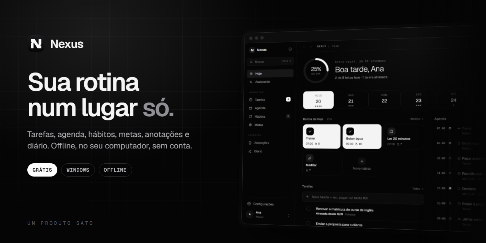
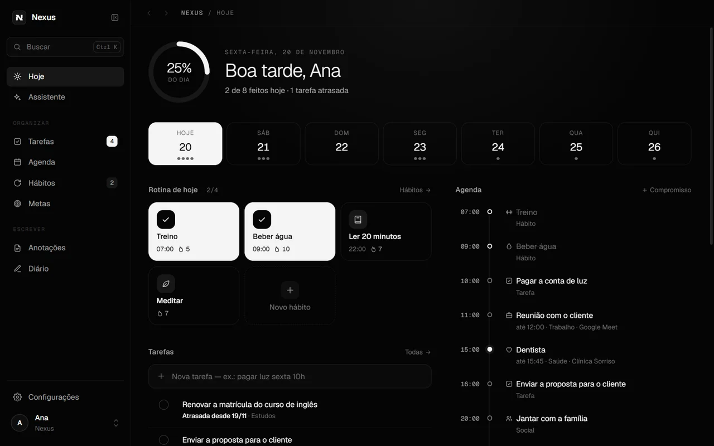
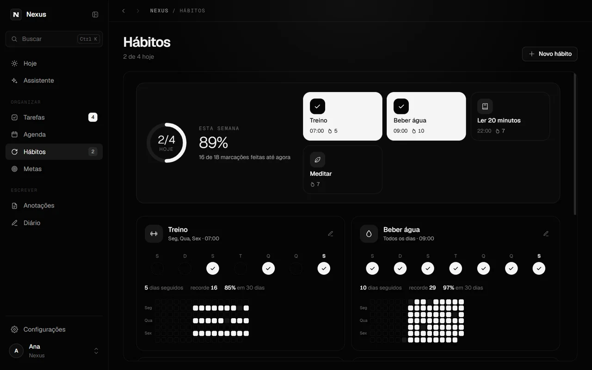
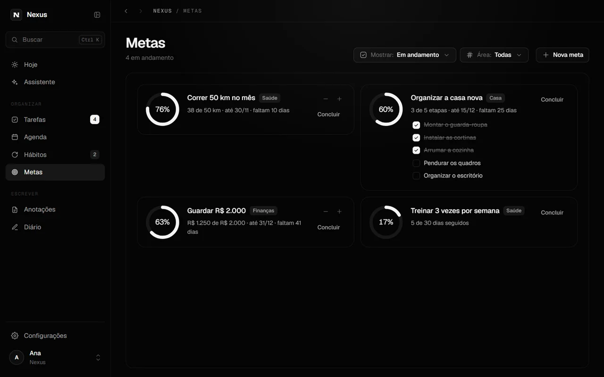
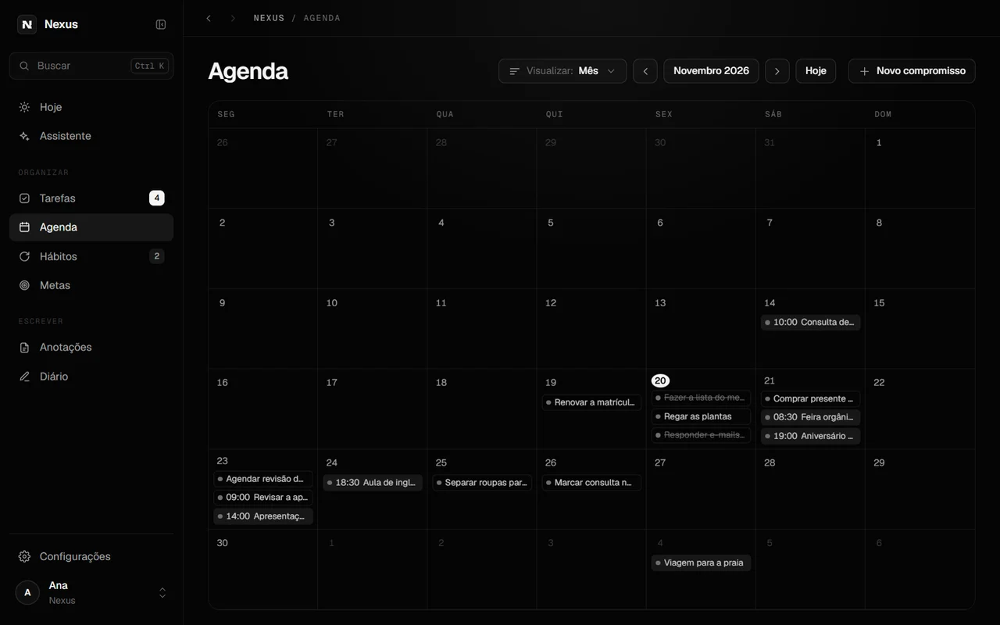
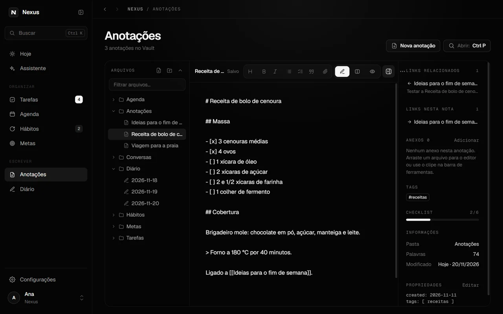
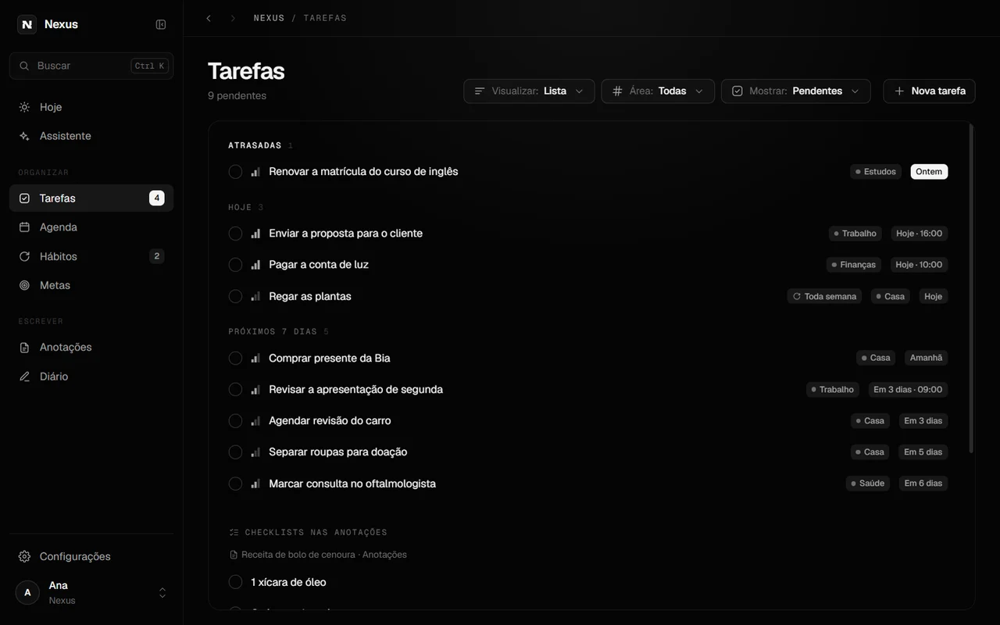
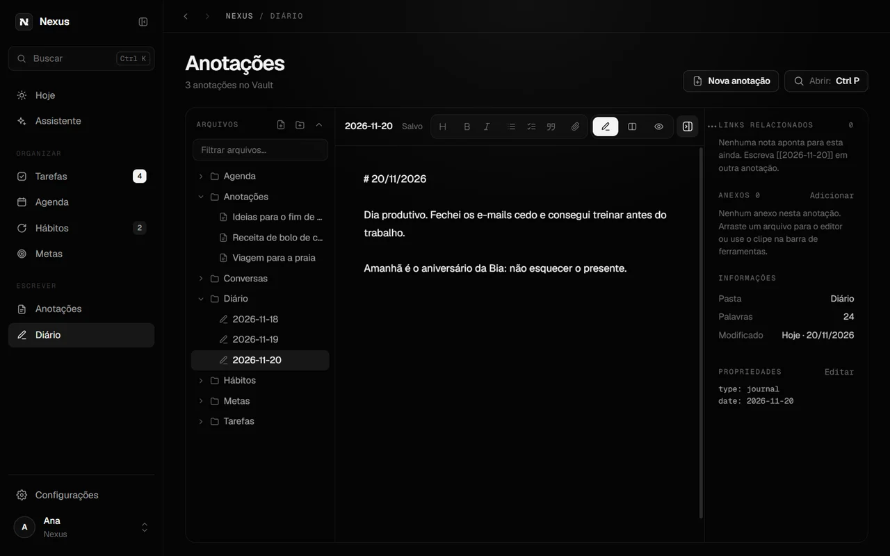
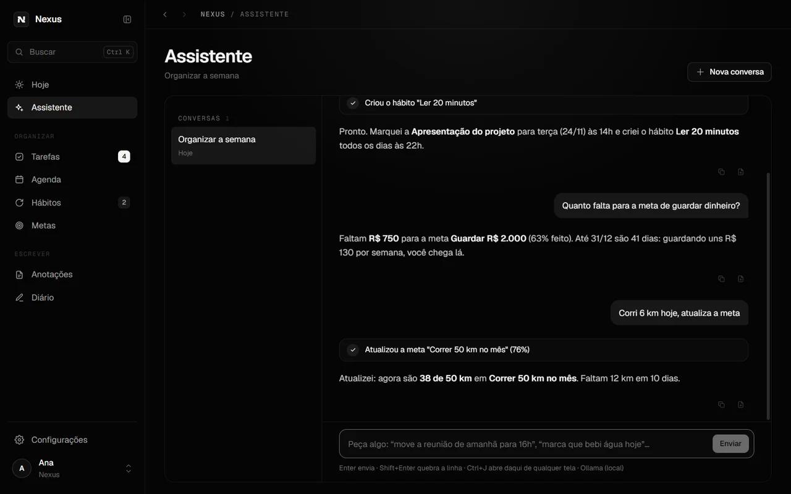

  

  

  
  
  
  

O **Nexus** junta a sua rotina num lugar só: tarefas, agenda, hábitos, metas, anotações e diário. Ele roda no seu computador, funciona sem internet e não pede conta nem cadastro. Tudo o que você escreve fica em arquivos comuns numa pasta que é sua.

Esta página é o lugar oficial para baixar o **Nexus Basic**, a versão grátis. O Nexus é um produto da **SATO**.

> [!TIP]
> **Nunca usou o GitHub?** Não precisa criar conta nem entender nada daqui. É só clicar no botão branco **Baixar o Nexus grátis** acima e seguir os 4 passos logo abaixo.

## Como baixar e instalar

  

1. **Clique em [Baixar o Nexus grátis](https://github.com/satostudios/Nexus/releases/latest/download/Nexus-Basic-Setup.exe).** O download do arquivo `Nexus-Basic-Setup.exe` começa sozinho. Se o navegador perguntar se quer manter o arquivo, escolha **Manter**.
2. **Abra o arquivo baixado.** Ele fica na pasta **Downloads** do seu computador. Dê dois cliques nele.
3. **Instale.** Clique em **Avançar**, depois em **Instalar** e, no fim, em **Concluir**. O Nexus abre sozinho e ganha um atalho na Área de Trabalho.
4. **Escolha uma pasta.** Na primeira vez, o Nexus pede uma pasta para guardar as suas coisas (o **Vault**). Pode ser uma pasta nova em Documentos. Pronto, é só usar.

<b>Apareceu "O Windows protegeu o computador"?</b>

 

Esse aviso azul aparece com programas novos que ainda não têm assinatura digital paga. O Nexus é seguro e não precisa de internet para funcionar.

1. Clique em **Mais informações**.
2. Clique em **Executar assim mesmo**.

<b>O download não começou?</b>

 

1. Abra a página de **[versões do Nexus](https://github.com/satostudios/Nexus/releases/latest)**.
2. Role até a parte **Assets**.
3. Clique em **`Nexus-Basic-Setup.exe`**.

## O que vem no Nexus Basic

  

<table>
  <tr>
    <td width="50%" valign="top">&nbsp;<b>Hoje</b> &nbsp;O dia inteiro numa tela: hábitos, agenda, tarefas, metas e o diário.</td>
    <td width="50%" valign="top">&nbsp;<b>Tarefas</b> &nbsp;Escreva "pagar luz sexta 10h" e o prazo entra sozinho. Lista ou quadro, com repetição.</td>
  </tr>
  <tr>
    <td valign="top">&nbsp;<b>Agenda</b> &nbsp;Mês, semana e dia, com compromissos, prazos e hábitos com horário.</td>
    <td valign="top">&nbsp;<b>Hábitos</b> &nbsp;Um clique marca. Sequência, recorde, taxa do mês e o histórico em quadradinhos.</td>
  </tr>
  <tr>
    <td valign="top">&nbsp;<b>Metas</b> &nbsp;Por número (50 km, R$ 2.000), por etapas ou pela sequência de um hábito.</td>
    <td valign="top">&nbsp;<b>Anotações</b> &nbsp;Editor com links entre notas, tags, checklists e anexos (PDF, imagem, vídeo, áudio).</td>
  </tr>
  <tr>
    <td valign="top">&nbsp;<b>Diário</b> &nbsp;Uma página por dia para escrever como foi.</td>
    <td valign="top">&nbsp;<b>Ilha</b> &nbsp;Uma janelinha no topo da tela: <b>Ctrl+Alt+N</b> em qualquer programa anota uma tarefa ou ideia na hora.</td>
  </tr>
  <tr>
    <td valign="top">&nbsp;<b>Busca</b> &nbsp;<b>Ctrl+K</b> acha qualquer tarefa, nota ou compromisso e roda comandos.</td>
    <td valign="top">&nbsp;<b>Seu e só seu</b> &nbsp;Sem conta, sem servidor e sem telemetria. Nada sai do seu computador.</td>
  </tr>
</table>

<table>
  <tr>
    <td width="50%"></td>
    <td width="50%"></td>
  </tr>
  <tr>
    <td></td>
    <td></td>
  </tr>
  <tr>
    <td></td>
    <td></td>
  </tr>
</table>

## Quer mais? Conheça o Nexus Advanced

O **Advanced** é a versão paga, com **pagamento único**. Ele traz tudo do Basic e mais o **Assistente de IA**: é só pedir e ele faz no app.

 

  

- *"Marca a apresentação do projeto na terça às 14h"*
- *"Passa as tarefas atrasadas para amanhã"*
- *"Cria uma meta de guardar R$ 2.000 até dezembro"*
- *"Corri 6 km hoje, atualiza a meta"*

O assistente cria, muda, conclui e organiza tarefas, compromissos, hábitos, metas, anotações e o diário. Cada ação aparece na conversa com um botão **Desfazer**. Ele também atende pela ilha, sem abrir o app.

| | Basic | Advanced |
| --- | :---: | :---: |
| Hoje, tarefas, agenda, hábitos, metas | ✓ | ✓ |
| Anotações, diário e busca | ✓ | ✓ |
| Ilha com captura rápida | ✓ | ✓ |
| Offline, sem conta | ✓ | ✓ |
| **Assistente de IA** que faz o que você pedir |  | ✓ |
| **Pedir à IA** pela ilha |  | ✓ |
| Preço | grátis | pagamento único |

  

O botão abre uma conversa no WhatsApp com a SATO, já com a mensagem pronta.

## Perguntas frequentes

<b>O Basic é grátis mesmo?</b>

 

Sim. Não custa nada, não tem anúncio, não pede cartão e não expira.

<b>Onde ficam as minhas coisas?</b>

 

Numa pasta que você escolhe (o Vault), em arquivos de texto comuns (Markdown). Dá para abrir em qualquer editor. Para usar em mais de um computador, coloque essa pasta no OneDrive, Google Drive ou Dropbox.

<b>Precisa de internet?</b>

 

Não. Depois de instalado, o Nexus funciona totalmente offline.

<b>Funciona no Mac, Linux ou celular?</b>

 

Por enquanto o instalador é só para Windows 10 e 11.

<b>Se eu comprar o Advanced, perco o que já fiz no Basic?</b>

 

Não. O Advanced instala por cima e usa a mesma pasta. Tudo continua lá.

<b>Como desinstalo?</b>

 

Em **Configurações do Windows → Aplicativos → Aplicativos instalados**, procure **Nexus** e clique em **Desinstalar**. A sua pasta com as anotações não é apagada.

<b>Cadê o código-fonte?</b>

 

O Nexus não é de código aberto. Este repositório existe só para distribuir o instalador grátis de um jeito seguro, direto da SATO.

## Sobre

O Nexus é um produto da **[SATO](https://github.com/satostudios)**. Dúvidas, sugestões ou problemas: [abra uma issue](https://github.com/satostudios/Nexus/issues) ou fale com a gente no [Instagram @sato_studios](https://www.instagram.com/sato_studios/).

O uso do Nexus segue os [termos de uso](TERMOS.md).
